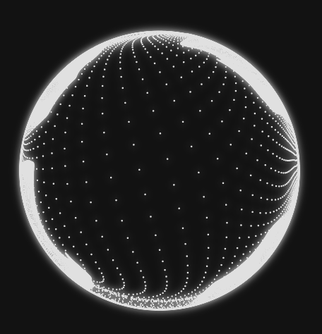

# Visualizer for SpotiKit

A Spotify visualizer with NCS, Spectrum, and Debug modes. Ported to SpotiKit by rxnl from Konsl's Spicetify Visualizer. [Original project](https://github.com/Konsl/spicetify-visualizer)

## Installation

1. Extract the archive.
2. In SpotiKit, open **Developer → Custom Apps** and copy the entire `visualizer` folder there. The manifest should be at `%APPDATA%\SpotiKit\Custom Apps\visualizer\spotikit.json`.
3. In SpotiKit, click **Apply to Spotify**.
4. In Spotify, click **Visualizer** in the top bar next to Marketplace, then play a track. Use the **⋯** menu to switch modes, change color of NCS sphere, enter fullscreen, or open the visualizer in a separate window.

The archive contains everything you need to install the app. [SpotiKit custom apps documentation](https://spotikit.com/docs/custom-apps)

## Features

- The visualizer uses Spotify's audio analysis and follows the track's playback position. If audio analysis is unavailable, NCS will play ambient animation.
- NCS requires WebGL2 with support for rendering to floating-point textures. Spectrum and Debug use Canvas 2D.
- In NCS mode, open the **⋯** menu to choose a custom sphere color or enable **Use cover art color**. The sphere slows down smoothly when you pause playback.
- Spectrum uses rhythm and pitch data. When rhythm data is unavailable, it displays 12 bars based on pitch.
- Debug displays beats, bars, loudness, analysis confidence, timbre, pitch, and rhythm when available. Vocal activity and three-band waveform plots are unavailable in this port.
- Opening the visualizer in a separate window requires pop-up or Picture-in-Picture support in the Spotify client.

## Building from source

In the `visualizer` folder, run `npm install` followed by `npm run build`. The build updates `index.js`. The app uses SpotiKit's React runtime.

The original project is distributed under the MIT License. See [LICENSE](LICENSE) and [LICENSE-fflate](LICENSE-fflate).
